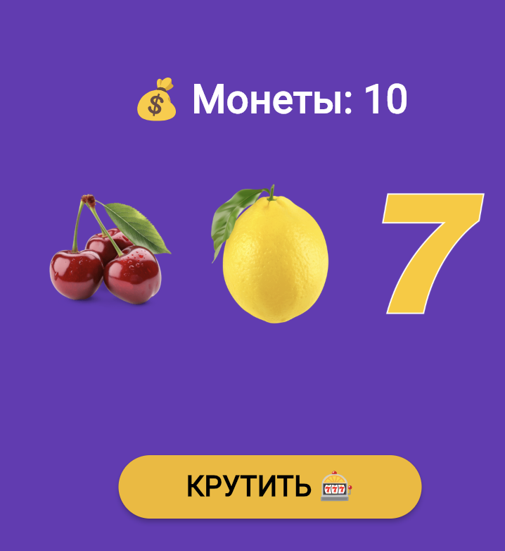

# Лабораторная работа №9. Flutter: StatefulWidget и управление состоянием

**ФИО:** Васильев Юрий
**Группа:** ИСП-241
**Дата сдачи:** 07.11.2026

## Скриншот финального приложения



## Что изучили

В ходе выполнения лабораторной работы были освоены следующие темы:
1. **Разница между `StatelessWidget` и `StatefulWidget`** — научились определять, когда виджету необходимо хранить изменяемое состояние, а когда достаточно статической конфигурации.
2. **Управление состоянием через `setState()`** — изучили, как правильно уведомлять Flutter об изменениях данных для перерисовки интерфейса.
3. **Подключение локальных ресурсов (assets)** — разобрались, как регистрировать изображения в `pubspec.yaml` и выводить их с помощью `Image.asset`.
4. **Асинхронность в UI** — научились использовать `Future`, `async/await` и `Future.wait` для создания реалистичной анимации барабанов, а также проверять `mounted` для предотвращения ошибок после удаления виджета.
5. **Создание анимаций** — применили `AnimatedOpacity` для плавного приглушения изображений во время вращения и `AnimatedSwitcher` для красивой смены текстовых сообщений.

##  Инструкция по запуску

1. Убедитесь, что у вас установлен Flutter SDK.
2. Клонируйте репозиторий:
```bash
   git clone https://github.com/YuriiSuperProg/Flutter_Lab9
   cd slot_machine_vasilev   
```
3. Получите зависимости и ресурсы:
```bash
    flutter pub get
```
4. Запустите приложение в браузере Chrome:
```bash
    flutter run -d chrome
```

## Как играть

* Нажмите «**КРУТИТЬ 🎰**», чтобы запустить барабаны.
* Три одинаковых символа дают **+3 монеты**.
* Три семёрки — это ДЖЕКПОТ **(+10 монет)**!
* Проигрыш отнимает 1 монету.
* Во время вращения кнопки заблокированы, чтобы нельзя было запустить игру повторно.
* Если монеты закончатся, кнопка вращения заблокируется. Нажмите «**Начать заново**», чтобы сбросить игру до 10 монет.