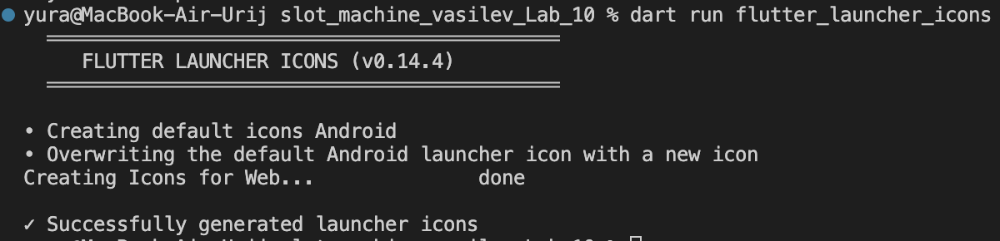
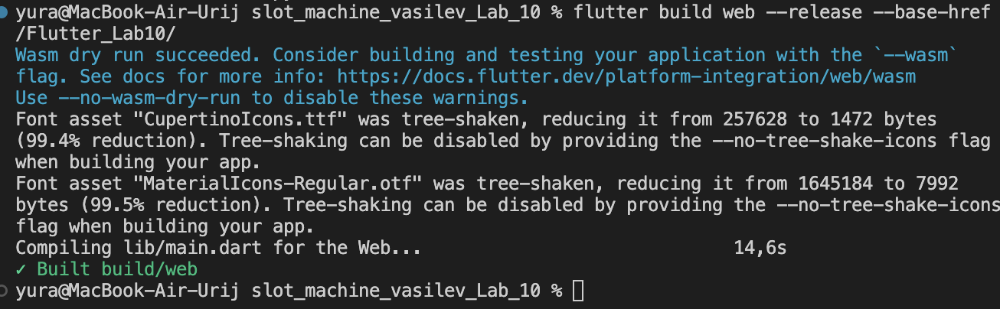

### Лабораторная работа №10. Слот-машина

**Автор:** Васильев Юрий
**Группа:** ИСП-241
**Дата сдачи:** 09.11.2026

## О проекте

Кроссплатформенное приложение «Слот-машина» на Flutter с локальным звуком, адаптивной вёрсткой и сборкой под Web и Android. Работа продолжает лабораторную №9 и добавляет:

* кроссплатформенный сервис звука на пакете audioplayers (Web и Android);

* фоновую музыку и звуковые эффекты с корректной работой аудиофокуса;

* обработку жизненного цикла приложения (сворачивание выключает звук);

* собственную иконку приложения;

## Запуск

```bash
    flutter pub get
    flutter run -d chrome
```

Звук включается отдельной кнопкой (значок динамика); до её нажатия приложение молчит — это соответствует политике автозапуска браузеров.

## Структура проекта

```bash
lib/
├── main.dart            # точка входа, адаптивная вёрстка
├── slot_machine.dart    # экран игры, звук, жизненный цикл
├── slot_row.dart        # ряд барабанов
└── sound_service.dart   # сервис музыки и эффектов

assets/
├── images/              # cherry.png, lemon.png, seven.png
├── sounds/              # background, click, win, lose, jackpot (mp3)
└── icon/                # app_icon.png
```

## Реализовано

* Музыка начинается по кнопке; эффекты не прерывают фон (аудиофокус `gain` у музыки, `none` у эффектов).

* Mute останавливает музыку и текущий эффект; повторное включение работает без создания копии фона.

* Сворачивание приложения / скрытие вкладки выключает звук; шторка уведомлений — нет.

* `dispose` освобождает оба плеера созданного экраном сервиса.

* Быстрые повторные нажатия не запускают второй spin (`_isSpinning` до любого `await` звука).

* Сохранены проверки `mounted` и адаптивный UI из №9.

## Скриншоты работы

1. 

2. 